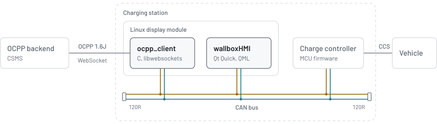

  <a href="https://fevzidereli.com">
    <picture>
      <source media="(prefers-color-scheme: dark)" srcset="assets/banner-dark.svg">
      <source media="(prefers-color-scheme: light)" srcset="assets/banner-light.svg">
      
    </picture>
  </a>

I write the software inside EV charging stations and vehicles: main control firmware for AC and DC chargers, the CAN architecture that ties their modules together, the OCPP stack that connects them to the backend, and the touchscreen the driver uses. I have been doing embedded work since 2019, anywhere between a bootloader and a Qt/QML interface, and I design the board when a project needs one.

More about my work at [fevzidereli.com](https://fevzidereli.com), or find me on [LinkedIn](https://www.linkedin.com/in/fevzi-dereli-245a5b135/).

## Work

- **DC fast chargers from 20 to 400 kW.** System design and main control software in C and C++ on Zephyr RTOS, speaking CAN, OCPP 1.6, IEC 61851 and ISO 15118.
- **A 22 kW AC charging station.** Control software and OCPP on Zephyr RTOS.
- **Chargers in the field.** `ocpp_client` and `wallboxHMI`, both open source below, run in eight DC chargers in Öckerö, Sweden.
- **Automotive electronics.** A battery management system on NXP S32K, a CAN bootloader for TI Hercules and a UDS (ISO 14229-1) diagnostics tool.
- **Edge AI.** Deep-learning applications on NVIDIA Jetson, including vehicle counting and tracking.

## How the open-source parts fit together

  <picture>
    <source media="(prefers-color-scheme: dark)" srcset="assets/stack-dark.svg">
    <source media="(prefers-color-scheme: light)" srcset="assets/stack-light.svg">
    
  </picture>

`ocpp_client` and `wallboxHMI` run side by side on the charger's Linux display module. Both listen to the charge controller on the same CAN bus, and the HMI writes the configuration that `ocpp_client` uses to reach the backend.

## Projects

**[OpenGG](https://github.com/fevz10/opengg)** &nbsp;`C++17` `Qt 6` `hidapi` 
An open-source alternative to SteelSeries GG for Linux. It sets keyboard lighting, mouse CPI, button mapping and battery alerts by talking to the devices directly over HID: no Electron, no account, no background service. Ships as a `.deb` with unit tests for every packet format.

  

**[Zephyr RTOS](https://github.com/zephyrproject-rtos/zephyr/pull/124673)** &nbsp;`C` `Devicetree` 
Upstream contribution, merged in November 2026: support for the on-board SPI NOR flash of the NXP FRDM-MCXN236.

**[ocpp_client](https://github.com/fevz10/ocpp_client)** &nbsp;`C` `libwebsockets` `cJSON` `SocketCAN` 
An OCPP 1.6J charge point client for embedded Linux. It reads live session data from the charge controller over CAN and reports it to the backend.

**[wallboxHMI](https://github.com/fevz10/wallboxHMI)** &nbsp;`Qt Quick` `QML` `C++` `CAN` 
The 800×480 touchscreen interface of a wallbox charger: charging flow, RFID cards and OCPP settings.

**[FDLib](https://github.com/fevz10/FDLib)** &nbsp;`Altium Designer` 
An Altium Designer library of 60+ components with schematic symbols, footprints and 3D STEP models.

## Toolbox

- **Languages:** `C` `C++` `Python` `QML` `C#`
- **Platforms:** `Zephyr RTOS` `Embedded Linux` `STM32` `NXP S32K` `TI Hercules` `NVIDIA Jetson`
- **Protocols and standards:** `CAN` `UDS (ISO 14229-1)` `OCPP 1.6` `ISO 15118` `IEC 61851`
- **Tools:** `Qt` `CMake` `Altium Designer` `Vector CANalyzer` `Git`
